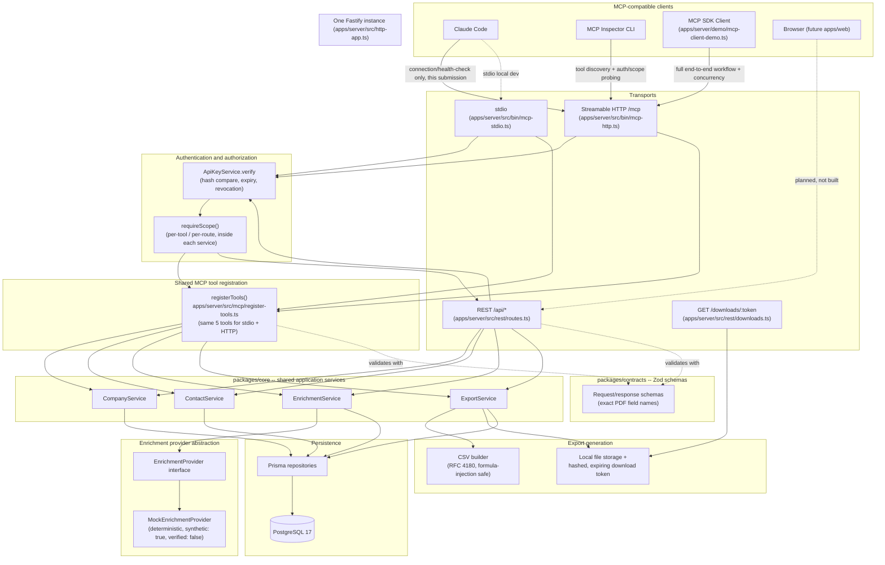

# Architecture

This reflects the actual code as of M7, not the original proposal in `account-intelligence-architecture.md`
(which stays the planning document; where the two differ, this file and the code win). Layering rule:
`packages/contracts` (Zod schemas) <- `packages/core` (services, repositories, auth, errors, logging) <-
`apps/server` (Fastify REST, MCP stdio/HTTP transports). `core` has zero dependency on Fastify or the MCP
SDK; `apps/web` (not yet built) will talk to the REST API only.

## Reading the diagram

- **MCP clients**: three distinct roles used in the M7 demonstration — Claude Code (connection/health
  verification only), MCP Inspector CLI (independent discovery + auth/scope probing), and the MCP SDK's
  own `Client` (the full workflow and concurrency demo). See `docs/demo/README.md`.
- **stdio and Streamable HTTP** both call the exact same `registerTools()` (`apps/server/src/mcp/
  register-tools.ts`) with the exact same `@aip/contracts` schemas and the exact same `@aip/core` service
  instances — there is one place tool logic is defined, not two.
- **Fastify HTTP application**: `apps/server/src/http-app.ts`'s `buildHttpApp()` mounts `/mcp`, `/api/*`,
  and `/downloads/:token` on one Fastify instance/port, so the download URL `export_contacts` returns
  resolves against the same running server that served the MCP call.
- **Authentication and authorization**: every transport authenticates through the same `ApiKeyService`
  (SHA-256 hash comparison, expiry, revocation — never trusting anything the client itself asserts about
  identity); scope checks (`companies:read`, `contacts:read`, `contacts:enrich`, `contacts:export`) are
  enforced inside each service method itself, so MCP and REST enforce identically by construction.
- **Shared core services**: `CompanyService`, `ContactService`, `EnrichmentService`, `ExportService` in
  `packages/core` are the single source of business logic; MCP and REST are both thin adapters around them.
- **Enrichment provider abstraction**: `EnrichmentProvider` is an interface; the only implementation today
  is `MockEnrichmentProvider`, a deterministic synthetic-fixture provider that never claims verification.
- **Export generation and secure CSV download**: `ExportService` builds a CSV, stores it locally, and
  returns a URL carrying a random token whose SHA-256 hash (not the raw token) is persisted; `GET
  /downloads/:token` is the only way to retrieve the file, and it expires.
- **Prisma and PostgreSQL**: the only persistence layer; `packages/core` repositories are the only code
  that imports Prisma.

## What is not shown (because it is not built)

`apps/web` (the planned Next.js frontend) is drawn only as a dashed, unimplemented edge into the REST API,
matching its actual status: not started. There is no rate limiter or health-check endpoint in the current
code (see `docs/submission-checklist.md` §8) — the diagram does not invent either.
